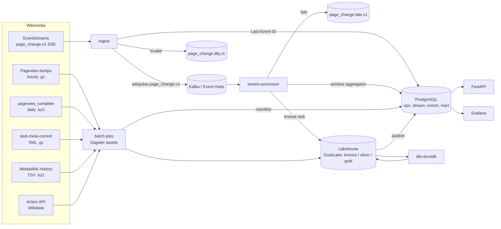

# Architecture

WikiPulse runs two long-lived services (stream ingest and stream processing) and a set of scheduled batch jobs.
They share one Kafka-protocol topic set, one lakehouse, and one PostgreSQL instance. Everything below runs
locally under Docker Compose and on Azure, with the same code and different configuration.

## Components and data flow

| Component | Runs as | Responsibility |
|---|---|---|
| ingest | long-lived service | SSE client, resume, schema validation, pseudonymisation, produce to Kafka |
| stream-processor | long-lived service (Quix Streams) | dedup, bronze sink, event-time windows, late routing, upserts to `stream.*` |
| batch jobs | Dagster assets (local daemon; Container Apps Jobs on Azure) | dump loading, XML parsing, enrichment, dbt, publish |
| lakehouse | DuckLake: catalog in PostgreSQL, Parquet data on local disk or ADLS Gen2 | bronze, silver, gold tables |
| PostgreSQL 18 | Compose container / Flexible Server | DuckLake catalog database, operational state, stream aggregates, serving marts |
| API | FastAPI service | read-only JSON API over `mart.*` and `stream.*` |
| Grafana | Grafana OSS | analyst dashboard and operations dashboard over PostgreSQL |

PostgreSQL holds two databases: `wikipulse` (schemas `ops`, `stream`, `enrich`, `mart`) and `lakehouse_catalog`
(DuckLake metadata). The full page-hour pageview fact (about 2.3M rows per hour for en+de) stays in the lake;
PostgreSQL holds only the marts the API and dashboard read.

## Streaming path

1. **ingest** opens `GET https://stream.wikimedia.org/v2/stream/mediawiki.page_change.v1` with the configured
   User-Agent. Each SSE `id:` line is a JSON array of `{topic, partition, timestamp|offset}`, one entry per
   Wikimedia datacenter topic, and it is stored as-is.
2. For each event the service:
   - drops it if `meta.domain == "canary"`
   - validates it against the vendored upstream JSON Schema for its `$schema` version. If the major version
     matches but the minor version is unknown, it validates against the highest known minor and increments
     `schema_drift_total`, because Wikimedia event schemas only allow backward-compatible changes within a major
     version. An unknown major version or a failed validation goes to the DLQ.
   - pseudonymises identity fields (see Privacy) and maps to the internal contract
     `docs/contracts/events/page_change_event.v1.json`
   - produces to `wikipulse.page_change.v1` with key `<wiki_id>:<page_id>` (idempotent producer, `acks=all`)
3. Every 5 s or 500 events, ingest calls `producer.flush()` and then writes the newest SSE id to
   `ops.stream_checkpoint`. The checkpoint never runs ahead of acknowledged messages.
4. EventStreams closes connections after 15 minutes. On any disconnect, ingest reconnects with
   `Last-Event-ID` set to the last checkpoint, using exponential backoff with jitter (1 s to 60 s). Events
   between the checkpoint and the disconnect are delivered again; the stream processor removes them.
5. If the process has been down longer than upstream retention (7 to 31 days, depending on the stream), resume
   is impossible. Ingest detects the gap by comparing the checkpoint timestamp with the first event received,
   then records it in `ops.stream_gaps`. Edit-level gaps are backfilled from MediaWiki History TSV once the
   monthly snapshot covers the period.

**stream-processor** (Quix Streams) consumes `wikipulse.page_change.v1`:

- **Dedup.** Each key keeps the `event_id`s seen in the last 24 h in RocksDB state. Duplicates share a key, so
  they land in the same partition and the same state store.
- **Bronze sink.** It writes deduplicated events to `bronze.page_change_events` in batches flushed at each
  checkpoint, together with the Kafka partition and offset range.
- **Windows.** Windows run on event time (`event_dt`):
  - 1-minute tumbling per `wiki_id × editor_type`, after `group_by(wiki_id)` repartitioning
  - 60-minute hopping with a 5-minute step per page

  Grace is 5 minutes. The measured p99 delivery lag on EventStreams is 23 s, so 5 minutes covers ingest
  restarts as well.
- **Late data.** Events that arrive after their window closed are passed to `on_late`. They are produced to
  `wikipulse.page_change.late.v1` and counted in `late_events_total`. They are still in bronze, because the
  bronze sink runs before windowing, so the batch recompute includes them.
- **Future timestamps.** Events whose `event_dt` is more than 10 minutes ahead of processing time go to the DLQ
  with reason `future_timestamp`, so a bad clock cannot advance the watermark. Old timestamps are not rejected;
  they are late by definition.
- Window results are upserted into `stream.wiki_activity_minute` and `stream.page_activity_window`, keyed by
  window and dimension. Replaying a window overwrites it with the same values.

Streaming aggregates are provisional. The hourly dbt run rebuilds `gold.fct_wiki_activity_hourly` from
`silver.page_change`, which includes late events. A reconciliation test then checks that the stream and batch
values differ by no more than the recorded late and duplicate counts for that hour.

## Batch path

Batch assets download and parse into raw files and bronze; dbt builds silver and gold. Every loading asset follows the same pattern:

1. List the source.
2. Compare it with `ops.batch_manifest`.
3. Download new or changed files to `raw/` in the lake root, computing the checksum while streaming.
4. Parse in bounded memory.
5. Replace the target partition in one DuckLake transaction.
6. Mark the manifest row `loaded`, with row counts.

Reruns of a loaded partition produce the same result. Backfill mode walks a date range; incremental mode
processes whatever is new since the last manifest entry.

| Asset | Partition | Source handling |
|---|---|---|
| `pageviews_hourly` | hour | 3 concurrent downloads at most (the dumps host limit). No checksums are published, so the manifest stores size, Last-Modified and a SHA-256 we compute. A daily sweep re-reads the month listings and reloads any hour whose size or mtime changed; Wikimedia does republish hours. Lines are streamed through gzip and filtered to `en`, `en.m`, `de`, `de.m` into bronze; title resolution happens in dbt (see data-model.md). |
| `page_snapshot_xml` | wiki × dump date | `stub-meta-current` parts are streamed through gzip into `xml.etree.ElementTree.iterparse`, clearing each `<page>` after use. The MD5 is computed on the streamed bytes and compared with `<wiki>-<date>-md5sums.txt` before commit. |
| `mediawiki_history` | wiki × month | Monthly TSV `.bz2` files, streamed and decompressed, keeping the revision and page event columns listed in the table contract. |
| `pageview_complete_daily` | day | User-agent daily file for reconciliation days only (default one day per week); filtered to en/de while streaming. |
| `enrichment` | daily | Pages that appear in trending, edit-burst or overlap outputs and are missing or older than 7 days in `enrich.page_info_cache`. |
| `eval_labels` | day | enwiki `Portal:Current events/<date>` links and Main Page links, via the Action API. |
| `dbt_build` | hourly | `dbt build` (models and tests) for the affected partitions. |
| `publish_serving` | hourly | Copies gold partitions into `mart.*` with delete+insert per partition in one PostgreSQL transaction. |

Large inputs are processed in bounded memory: gzip, bz2 and XML are read as streams, and rows are written in
Parquet row groups of 1M rows. DuckDB runs with `memory_limit=1GB`, `threads=2`, and a capped spill directory.
The build measures peak RSS and throughput for each asset and records them in this document.

### Outbound HTTP rules

All outbound HTTP goes through one client in `libs/common`:

- **User-Agent:** `WikiPulse/<version> (<contact>) python-httpx/<version>`. The contact comes from configuration
  only.
- **Throttling:** a token bucket per host, set to 150 requests/min for the Action API and Wikidata. The limit for
  clients that send a compliant User-Agent is 200/min.
- **Action API parameters:** `maxlag=5`, with at most 50 titles or IDs per request.
- **Errors:** on 429, 503 or a maxlag error the client honours `Retry-After` (at least 5 s), backs off
  exponentially, and then fails the asset run.
- **Concurrency:** API calls are serial. Dump downloads use at most 3 connections.
- Requests are never spread across identities or IPs.

## Delivery semantics and failure handling

Delivery is at-least-once end to end, with idempotent writes:

| Hop | Guarantee | Mechanism |
|---|---|---|
| EventStreams → ingest | at-least-once | resume from checkpointed `Last-Event-ID`; checkpoint written after flush |
| ingest → Kafka | at-least-once, no producer duplicates on retry | idempotent producer, `acks=all` |
| Kafka → bronze | at-least-once | offsets committed after the sink flush (Quix checkpoint) |
| bronze → silver | effectively once | dedup on `event_id` in dbt (`qualify row_number() over (partition by event_id ...) = 1`) |
| Kafka → `stream.*` | effectively once | upsert keyed by window and dimension |
| dumps → lake | effectively once | partition replace in one transaction + manifest |
| gold → `mart.*` | effectively once | delete+insert per partition in one transaction |

Exactly-once processing is not claimed. Quix Streams can use Kafka transactions, but Event Hubs Standard does not
support them, and keeping one code path is worth more than exactly-once locally.

| Failure | Detection | Handling |
|---|---|---|
| SSE disconnect (including the 15-min server timeout) | stream EOF or error | reconnect with `Last-Event-ID`; duplicates removed downstream |
| ingest crash | container restart; `ingest_last_event_age_seconds` | resume from `ops.stream_checkpoint` |
| Outage longer than upstream retention | checkpoint timestamp older than the first event received | row in `ops.stream_gaps`; backfill from History TSV |
| Malformed or invalid event | schema validation | DLQ with `reason_code`, original payload, schema version |
| Upstream schema minor change | `$schema` version not vendored | validate against highest known minor; `schema_drift_total` metric; warning log |
| Duplicate event | `event_id` seen in state | dropped in the processor, and again in silver |
| Late event | window closed beyond grace | late topic + metric; included in the batch recompute |
| Kafka unavailable | producer delivery errors | ingest stops reading and stops checkpointing, then resumes from the checkpoint |
| PostgreSQL unavailable | sink errors | processor stops committing offsets and retries; no loss |
| Dump file republished | size or mtime differs from the manifest | partition reloaded; manifest keeps history |
| Dump checksum mismatch | MD5 compared after streaming | partition not committed; asset fails |
| Dump not yet published | 404 | asset retries on the next schedule; freshness alert after 6 h (p95 delay is 2.8 h) |
| API rate limit | 429, 503, maxlag | Retry-After and backoff; run fails cleanly after 5 attempts |
| HDD data root not mounted (local) | startup and `/readyz` check | service refuses to start, so nothing is written to the SSD mountpoint |

## Privacy and security

Usernames in the stream identify real people, and IP addresses identified unregistered editors before temporary
accounts. WikiPulse keeps no per-person data and publishes no per-person output.

- Ingest computes `editor_key = HMAC-SHA256(key, "<wiki_id>:<user_id>")`, truncated to 16 bytes. When `user_id`
  is absent it uses the user text instead. Keys are per wiki, so the same person on two wikis gets unrelated keys. The output is used only to count distinct editors. The key lives in Key Vault (on Azure) or in
  `.env` (locally) and never in code. Within the dataset the key gives the same editor the same value; outside
  the dataset it cannot be reversed or joined.
- `user_text`, `user_id`, edit comments, edit counts, registration dates and user groups are dropped before
  the event reaches Kafka. Groups are used only to derive `editor_type`.
- `editor_type` is one of:
  - `bot`: `is_bot`
  - `system`: `is_system`
  - `temp`: `is_temp`
  - `anonymous_ip`: no user id and the user text is an IP address. This value is kept for history rows from
    before temporary accounts; no IP editors were seen in the live stream.
  - `registered`: everything else
- MediaWiki History TSV usernames and IPs are dropped while parsing; only the HMAC key and `editor_type` remain.
- No article text is stored. The XML parser skips `<text>` content and reads only its `bytes` and `sha1`
  attributes.
- The API and dashboard show page-level and wiki-level aggregates only. No endpoint accepts or returns an editor
  identifier.
- Secrets live in `.env` (gitignored) locally, and in Key Vault read through managed identity on Azure.
  PostgreSQL and Event Hubs use Microsoft Entra authentication with managed identity on Azure, so there are no
  passwords there. The API and Grafana connect with a read-only PostgreSQL role.

## Observability

- **Logs:** JSON to stdout, one event per line, with `service`, `level`, `event`, and context fields. Container
  Apps sends stdout to Log Analytics.
- **Metrics:** recorded with the OpenTelemetry API. Locally they are exported over OTLP to Prometheus; on Azure,
  the Azure Monitor exporter sends them to Application Insights.

| Service | Metrics |
|---|---|
| ingest | `events_received_total{wiki_id}`, `events_produced_total`, `dlq_total{reason_code}`, `schema_drift_total`, `ingest_last_event_age_seconds`, `sse_reconnects_total` |
| stream-processor | `duplicates_dropped_total`, `late_events_total{window_kind}`, `consumer_lag_messages{partition}`, `sink_flush_seconds` |
| batch | `asset_rows_total{asset}`, `asset_duration_seconds`, `asset_peak_rss_bytes`, `http_requests_total{host,status}`, `http_throttled_seconds_total` |
| api | request rate, latency histogram and error rate per route; DB pool wait time |

- **Freshness:** `ops.pipeline_freshness` is a view over the manifest, the checkpoints and `stream.*` max window
  times, giving each source's last complete period and its lag. `/v1/freshness`, `/readyz` and the dashboards read
  this view, so freshness can be checked on both environments without the metrics backend.
- **Alerts:** defined as Grafana alert rules locally and as Azure Monitor alerts in Terraform:
  - stream event age > 5 min
  - consumer lag > 10,000 messages
  - DLQ rate > 1% over 15 min
  - pageview freshness > 6 h
  - failed asset runs

## Measured source volumes

Measured 2026-10-27 and 2026-10-28 with short spikes. The build re-measures the stream over 24 h and records the
result here.

| Source | Measurement |
|---|---|
| EventStreams `mediawiki.page_change.v1` (schema 1.12.0) | 17.25 events/s over 90 s; 2,775 B mean raw JSON; about 48 KB/s, 1.49M events/day, 4.1 GB/day raw. 40.8% bot, 3.1% temporary accounts, 0 IP editors. Kinds in sample: edit 81%, create 18%, delete 0.5%, move 0.3%. 0 duplicate `meta.id` in 735 events. |
| EventStreams `recentchange` (reference, not ingested) | 34.9 events/s over 120 s; 1,358 B mean; 49% `categorize`. No `page_id`. Delivery lag p50 4.9 s, p99 23.3 s, max 14.9 years (old timestamps on categorize/log events). |
| Pageviews hourly, September 2026 | 720 files; median 61.0 MB gzip (min 44.6, max 80.4); 1.34 to 1.65 GB per day; 43.1 GB per month. |
| One pageview hour (2026-10-27 12:00) | 52.2 MB gzip, 184.9 MB uncompressed, 5.94M lines, 1,756 domain codes, 16.1M views. Download and parse took 72 s, limited by the download. |
| en, en.m, de, de.m within that hour | 2.29M lines (38.6%), 7.82M views (48%). en.m alone: 976k lines, 4.31M views. |
| Pageview publication delay | median 2.20 h after the hour, p95 2.77 h, max 20.1 h. |
| pageview_complete daily, user agent | 0.72 to 0.86 GB bz2 per day. |
| stub-meta-current, run 2026-10-01 | enwiki 7.85 GB gzip in 27 parts; dewiki 1.09 GB. Parse rate 7.5 MB/s uncompressed (download-bound). |
| MediaWiki History TSV, snapshot 2026-09 | enwiki 520 to 585 MB bz2 per month; dewiki about 1 GB per year, about 85 MB per month. |
| Rejected: XML with revision history | stub-meta-history: enwiki 124 GB, dewiki 23.8 GB, and sunset in January 2027. mediawiki_content_history: enwiki 1.94 TB, dewiki 496 GB. |

## Coverage

| Input | Coverage | Reason |
|---|---|---|
| Stream | all public wikis; page-level gold for enwiki and dewiki | 17 events/s is small enough to keep everything for per-wiki activity; page-level joins need pageviews, which are loaded for en and de only |
| Pageviews hourly | `en`, `en.m`, `de`, `de.m`; 35 days (7-day baseline + 28-day evaluation) | 840 files, about 51 GB downloaded; about 5.6 h once at 3 connections, then incremental. The `quick` profile loads 8 days. |
| stub-meta-current XML | enwiki and dewiki, latest monthly run | page dimension for title resolution; published long term |
| MediaWiki History TSV | enwiki and dewiki, last 3 complete months | edit-rate baselines and revert ground truth; about 1.9 GB |
| pageview_complete | one day per week of the window | reconciliation of title resolution against Wikimedia's own page_id attribution |

enwiki provides real scale (1.87M pageview rows per hour) and structured evaluation labels (Portal:Current
events). dewiki adds a second language with non-ASCII titles. The first end-to-end slice uses dewiki alone,
because its XML is 1.09 GB against 7.85 GB for enwiki. See ADR 0009.

## Local topology

`compose.yaml` runs the following within the 7 GB machine:

| Container | Memory limit |
|---|---|
| kafka (`apache/kafka:4.4.0`, KRaft single node, heap 512 MB) | 768 MB |
| postgres (18) | 512 MB |
| ingest | 128 MB |
| stream-processor | 384 MB |
| dagster-webserver | 384 MB |
| dagster-daemon (runs launched in-process) | 1.25 GB |
| api | 128 MB |
| grafana (13.x) | 256 MB |
| prometheus | 192 MB |

Planned steady state is about 2.6 GB, with a peak of about 4.0 GB during dbt and backfills; the build measures
both.

Storage placement (ADR 0013):

- **HDD**, under `WIKIPULSE_DATA_ROOT`: the DuckLake data path and raw files. The external drive is NTFS over
  FUSE; sequential Parquet and gzip I/O suits it. For the 35-day window this is about 90 GB:

  | Data | Size |
  |---|---|
  | raw pageviews | 50 GB |
  | raw XML | 8.9 GB |
  | raw History TSV | 2 GB |
  | bronze stream | 0.45 GB/day |
  | silver and gold pageviews | 13 GB |

- **SSD**, Docker named volumes: PostgreSQL data, Kafka logs (3-day retention, about 1.4 GB), RocksDB state,
  and the DuckDB spill directory (4 GB cap). PostgreSQL requires POSIX ownership and 0700 permissions on its data
  directory, which NTFS over FUSE cannot provide, and these workloads are fsync-heavy.

Configuration:

- Non-secret settings are in `config/wikipulse.toml`: wikis, windows, thresholds, rate limits, retention. Any key
  can be overridden by an environment variable `WIKIPULSE_<SECTION>__<KEY>`.
- The values only the operator provides are `WIKIPULSE_HTTP__CONTACT`, `WIKIPULSE_DATA_ROOT` and the HMAC key.
  They live in the gitignored `.env`, and `.env.example` documents them.

## Azure topology

| Concern | Azure resource | Configuration |
|---|---|---|
| Messaging | Event Hubs namespace, Standard, 1 TU | Kafka endpoint; event hubs pre-created by Terraform (the main topic, DLQ, late, plus the Quix changelog and repartition topics); 1-day retention; producer compression off (Standard does not support it) |
| Lake | Storage account StorageV2 with hierarchical namespace (ADLS Gen2), Hot LRS | container `lake`; lifecycle rule moves `raw/` to Cool after 30 days and deletes after 90 |
| Database | PostgreSQL Flexible Server 18, Burstable B1ms, 32 GB | Entra authentication; `wikipulse` and `lakehouse_catalog` databases |
| Services | Container Apps environment (Consumption) | ingest 0.25 vCPU/0.5 GiB min 1; stream-processor 0.5 vCPU/1 GiB min 1; api and grafana 0.25 vCPU/0.5 GiB min 0 with HTTP scale |
| Batch | Container Apps Jobs | cron-triggered `dagster asset materialize --select ... --partition ...`; 1 vCPU/2 GiB |
| Secrets | Key Vault Standard | HMAC key, Grafana admin password; read through user-assigned managed identity |
| Observability | Log Analytics workspace + workspace-based Application Insights | daily ingestion cap 0.15 GB (inside the free 5 GB/month) |
| Images | GitHub Container Registry | public images; no ACR |
| IaC / CI | Terraform (azurerm 5.11.0), state in a separately bootstrapped storage account; GitHub Actions with OIDC (`azure/login@v3`) | `make azure-up` = `terraform apply`; `make azure-down` = `terraform destroy` of the workload resource group |

Dagster runs without a daemon or webserver on Azure. The same asset definitions run as Container Apps Jobs, and
schedules are cron expressions on those Jobs. This avoids an always-on orchestrator container; the Dagster UI is
a local tool. See ADR 0006.

## Cost estimate (Azure, eastus retail prices, October 2026)

Assumptions:

- The environment runs 24/7 for a full month (730 h).
- Stream volume is 17.25 events/s, about 45M events/month.
- Container Apps free grants apply: 180,000 vCPU-s and 360,000 GiB-s per month.
- No free-tier PostgreSQL.
- USD.

| Item | Basis | Monthly |
|---|---|---|
| Event Hubs Standard | 1 TU × $0.03/h + 45M ingress events × $0.028/M | $23.2 |
| PostgreSQL Flexible B1ms | $0.017/h + 32 GB × $0.115/GB-month | $16.1 |
| Container Apps, always-on | 0.75 vCPU and 1.5 GiB active: 1.97M vCPU-s × $0.000024 + 3.94M GiB-s × $0.000003, minus free grants | $53.8 |
| Container Apps Jobs | hourly dbt/publish about 4 min at 1 vCPU/2 GiB, plus incremental loads | about $6 |
| ADLS Gen2 | about 70 GB Hot × $0.021, plus transactions | about $2 |
| Log Analytics | under the daily cap | $0 |
| Key Vault | operations × $0.03/10k | under $0.10 |
| **Total if left on** | | **about $101/month, $3.3/day** |

The one-time 35-day backfill costs roughly $3 of job compute. The $100 student credit therefore supports
session-based use: `make azure-up` for a demonstration or evaluation run, `make azure-down` afterwards. At 10 days
per month this is about $35. If the subscription qualifies for the 12-month free B1ms offer, subtract $16.1 per
month. The build records real spend from Cost Management after the first week of use.

## GCP equivalents

| Azure | GCP |
|---|---|
| ADLS Gen2 | Cloud Storage |
| Event Hubs (Kafka endpoint) | Managed Service for Apache Kafka |
| PostgreSQL Flexible Server | Cloud SQL for PostgreSQL |
| Container Apps / Container Apps Jobs | Cloud Run services / Cloud Run jobs |
| Key Vault + managed identity | Secret Manager + service accounts |
| Log Analytics / Application Insights | Cloud Logging / Cloud Monitoring |
| GitHub OIDC to Entra | GitHub OIDC to Workload Identity Federation |
| API Management (optional) | API Gateway |
| Terraform azurerm | Terraform google |

On GCP, BigQuery would be the usual choice for the gold layer instead of DuckDB over object storage. The
DuckLake, dbt and Parquet layout ports unchanged to Cloud Storage.
