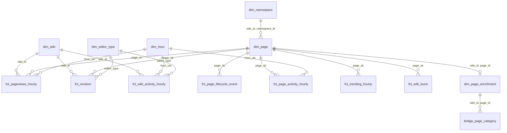

# Data model

Column-level definitions, keys, partitioning and tests for every table are in `docs/contracts/tables/`. This
document covers the layers, the star schema, page identity, and the definition and evaluation of each analytic.

Conventions:

- **Timestamps:** `timestamptz`/`TIMESTAMP WITH TIME ZONE` in UTC. An hour is identified by its start,
  `hour_utc`.
- **Wiki identifier:** the database name, `wiki_id` (`enwiki`, `dewiki`).
- **Page identity:** `(wiki_id, page_id)`. Titles are attributes, never keys.
- **Partitioning:** lake tables use Hive-style lowercase partition columns. PostgreSQL tables above about 1M rows
  are range-partitioned by month.

## Layers

| Layer | Store | Content | Written by |
|---|---|---|---|
| raw | `${DATA_ROOT}/raw/<source>/...` (files) | source files exactly as downloaded | batch assets |
| bronze | DuckLake schema `bronze` | one row per source record, parsed into typed columns (XML and TSV are parsed here; identity already pseudonymised), with lineage (`source_file`, `line_no` or Kafka `partition`/`offset`, `loaded_at`) | stream-processor sink, batch assets |
| silver | DuckLake schema `silver` | deduplicated, fully typed, conformed: `wiki_id` mapped, titles normalised and resolved to `page_id`, page versions built | dbt |
| gold | DuckLake schema `gold` | star schema: conformed dimensions, facts at stated grain, detection outputs, evaluation and DQ results | dbt |
| serving | PostgreSQL schema `mart` | gold subsets shaped for API queries | `publish_serving` |
| stream | PostgreSQL schema `stream` | provisional window aggregates | stream-processor |
| ops | PostgreSQL schema `ops` | manifest, checkpoints, gaps, freshness | ingest, batch assets |
| enrich | PostgreSQL schema `enrich` | API response cache with fetch time | enrichment asset |

Batch assets only download and parse: they write raw files and bronze. Every silver and gold table is a dbt
model, so title resolution can use page versions without a dependency cycle.

Bronze and silver tables:

| Table | Grain | Source |
|---|---|---|
| `bronze.page_change_events` | one row per received internal event (duplicates possible) | Kafka `wikipulse.page_change.v1` |
| `bronze.pageviews_hourly` | one row per line of an hourly file for en/en.m/de/de.m | pageview dumps |
| `bronze.page_snapshot_xml` | one row per `<page>` in a stub-meta-current part | XML dumps |
| `bronze.mediawiki_history` | one row per revision event row | History TSV |
| `bronze.pageview_complete_daily` | one row per line, en/de user agent | pageview_complete |
| `silver.page_change` | one row per `event_id` | bronze, deduplicated |
| `silver.pageviews_hourly` | one row per (wiki_id, page_id, hour_utc, access_method) | bronze, resolved and summed |
| `silver.pageviews_unresolved` | one row per (wiki_id, normalised title, hour_utc, access_method) not resolved | bronze |
| `silver.page_snapshot` | one row per (wiki_id, page_id, snapshot_date) | bronze XML |
| `silver.page_versions` | one row per (wiki_id, page_id, valid_from): SCD2 page state | snapshots + stream lifecycle events |
| `silver.revision_history` | one row per (wiki_id, rev_id) | History TSV |
| `silver.pageview_complete_daily` | one row per (wiki_id, page_id, date, access_method) | pageview_complete |
| `bronze.eval_label_links` | one row per link fetched from a label page | Action API |
| `silver.eval_labels` | one row per (label_set, wiki_id, label_date, page_id) | `bronze.eval_label_links`, resolved |

## Star schema

Dimensions:

| Dimension | Key | Notes |
|---|---|---|
| `dim_wiki` | `wiki_id` | language, project, pageview domain codes (desktop and mobile), page-level coverage flag. Every wiki seen on the stream gets a row. |
| `dim_namespace` | `(wiki_id, namespace_id)` | localised name, `is_content` |
| `dim_editor_type` | `editor_type` | `bot`, `temp`, `registered`, `anonymous_ip`, `system`, with descriptions |
| `dim_hour` | `hour_utc` | date, hour of day, ISO day of week, ISO week |
| `dim_page` | `page_sk` (surrogate); natural key `(wiki_id, page_id, valid_from)` | SCD type 2, described below |
| `dim_page_enrichment` | `(wiki_id, page_id)` | Wikidata item, entity type (P31 label), category count, `fetched_at`. Type 1, overwritten on refresh. |
| `bridge_page_category` | `(wiki_id, page_id, category_title)` | many-to-many between pages and categories |

Facts. The grain is stated as "one row per ...". Additive measures can be summed across every dimension except
where noted.

| Fact | Grain | Measures | Stored |
|---|---|---|---|
| `fct_pageviews_hourly` | one row per page, hour, and access method (`desktop`, `mobile-web`) | `views`, `via_redirect_views` | lake only; partitioned by `wiki_id`, `date`; sorted by `page_id` |
| `fct_revision` | one row per revision (`wiki_id`, `rev_id`) | `rev_size`, `size_delta`, `is_minor`, `is_revert`, `revert_method`, `revert_original_rev_id`, `is_identity_reverted` (from History TSV when available) | lake; partitioned by `wiki_id`, `month` |
| `fct_page_lifecycle_event` | one row per create, move, delete or undelete event (`event_id`) | `prior_title`, `new_title`, `prior_namespace_id`, `new_namespace_id` | lake |
| `fct_page_activity_hourly` | one row per page and hour with at least one view or edit | `views`, `edits`, `non_bot_edits`, `reverts`, `distinct_editors` (not additive across hours) | lake; mart copy for pages with ≥ 1 edit or views above the floor |
| `fct_wiki_activity_hourly` | one row per wiki, hour and editor type | `edits`, `creates`, `moves`, `deletes`, `reverts`, `distinct_pages`, `distinct_editors` (not additive across hours or editor types) | lake and mart; all wikis |
| `fct_trending_hourly` | one row per page and hour where views ≥ the wiki's floor | `views`, `baseline_median`, `baseline_mad`, `robust_z`, `ratio`, `rank_in_wiki_hour`, `is_trending` | lake and mart |
| `fct_edit_burst` | one row per detected burst (`wiki_id`, `page_id`, `window_start`) | `edits`, `distinct_editors`, `reverts`, `baseline_rate_per_hour`, `poisson_p` | lake and mart |
| `fct_read_edit_overlap` | one row per page and read-surge hour that has an edit burst within ±1 h | `surge_hour`, `burst_window_start`, `lead_minutes` (negative when the edits came first) | lake and mart |

Evaluation and data-quality results go to `gold.eval_detection_daily`, `gold.eval_revert_agreement` and
`gold.dq_reconciliation`. The `mart.evaluation_summary` copy is served at `/v1/evaluation`.

## Page identity and history

Pages are identified by `(wiki_id, page_id)`. A page keeps its `page_id` through renames and moves. Deleting a
page removes its `page_id`; undeleting may restore the old id.

`silver.page_versions` (exposed as `gold.dim_page`) is SCD type 2 with one version per contiguous period of identical tracked attributes: `title`,
`namespace_id`, `is_redirect`, `redirect_target_page_id`, `is_deleted`. It is built from two inputs:

1. **Monthly snapshots** (`silver.page_snapshot`, from stub-meta-current). Each snapshot gives the attribute
   values at 00:00 UTC on the dump date. Pages that appear in a snapshot and not in the previous one are
   creations or undeletions. Pages that disappear are deletions, unless a stream delete already recorded them.
2. **Stream lifecycle events** (`fct_page_lifecycle_event`). `create`, `move` (title or namespace from
   `prior_state` to `page`), `delete` and `undelete` open a new version at the event's `event_dt`. Edits that
   change `is_redirect` also open a new version.

When both inputs cover a period, stream events give the exact change time and the next snapshot confirms the
result. A snapshot that disagrees with the stream-derived state for a page is recorded in `gold.dq_reconciliation`
(`check_name = snapshot_vs_stream_state`), and the snapshot value wins from the snapshot time onward. Version
boundaries are half-open, `[valid_from, valid_to)`, and `valid_to` is `9999-12-31` for current versions.
`page_sk` is a hash of `(wiki_id, page_id, valid_from)`.

Facts join to the version valid at the event time (`valid_from <= event_time < valid_to`), so a page renamed on
Tuesday reports under its old title for Monday's hours. Facts also carry `page_id`, so the current title is always
one join away (`mart.page_current`), and `mart.page_title_history` exposes the versions.

### Resolving pageview titles to page IDs

Hourly pageview rows carry titles only. Resolution for row (domain code, title, hour):

1. Map the domain code to `wiki_id` and `access_method` (`en` → enwiki/desktop, `en.m` → enwiki/mobile-web, and
   likewise for de).
2. Normalise the title:
   - percent-decode once (invalid sequences are kept as-is)
   - replace spaces with underscores
   - uppercase the first character, since both wikis use first-letter capitalisation
   - strip a leading `:`
   - split a namespace prefix using the wiki's localised and canonical namespace names from `dim_namespace`
3. Look up `(wiki_id, namespace_id, title)` in `silver.page_versions` at the version valid at `hour_utc`.
4. If that version is a redirect, attribute the views to `redirect_target_page_id` and add them to
   `via_redirect_views` as well. Only one hop is followed, because MediaWiki does not follow double redirects
   either.
5. Rows that do not resolve go to `silver.pageviews_unresolved`. Expected causes are nonexistent titles, special
   pages, malformed requests, and pages created after the last snapshot that have no lifecycle event in the
   stream yet. The row keeps its views, and the resolution is retried for the 48 hours after each new snapshot or
   stream window.

Data-quality metric: the resolved share of views per wiki-hour. The threshold is set from the first measured
backfill and recorded here. The test fails if an hour falls more than 3 percentage points below the 7-day
median, which catches a broken normaliser or a missing snapshot. A second check sums resolved hourly views per
page and day and compares them with `pageview_complete` (Wikimedia's own attribution by `page_id`), giving the
match rate and the total-views difference per wiki-day.

## Data-quality tests

dbt tests on every gold model, plus these checks:

| Type | Checks |
|---|---|
| Not null | keys and required measures |
| Unique | the declared grain of every fact; `event_id` in `silver.page_change`; `(wiki_id, rev_id)` in `fct_revision` |
| Relationships | every fact `page_sk` resolves in `dim_page`; every `wiki_id` resolves in `dim_wiki`; `editor_type` in `dim_editor_type` |
| Accepted values | `access_method`, `editor_type`, `change_kind`, `revert_method`, `check_name`, manifest `status` |
| Freshness | stream `max(event_dt)` within 5 min; pageviews within 6 h; snapshot within 40 days; History TSV within 45 days |
| Reconciliation (results in `gold.dq_reconciliation`) | stream vs batch: `stream.wiki_activity_minute` summed to the hour vs `fct_wiki_activity_hourly`, with absolute difference ≤ that hour's recorded late events plus duplicates; title resolution vs `pageview_complete` (above); stream edits vs `silver.revision_history` per wiki-day for days covered by both; snapshot vs stream page state |
| Volume | rows per pageview hour within ±40% of the trailing 7-day median for the same hour of day; stream events per hour above 25% of the trailing median |

## Analytics

All detection methods use only data available at the scoring time: the baselines use trailing windows that end
before the scored hour. Thresholds live in `config/wikipulse.toml`, with the values below as defaults.

### Read surges (trending)

- **Input:** `fct_pageviews_hourly`, summed over access methods, for each `(wiki_id, page_id, hour)`. Hours with
  no row count as 0 views; the source omits zero rows.
- **Baseline:** over the trailing 168 hours `[h-168, h-1]`, the median `m` and the median absolute deviation
  `MAD` of hourly views.
- **Score:** `robust_z = (v - m) / (1.4826 × MAD + 1)` and `ratio = v / (m + 1)`. The `+ 1` terms keep both
  finite for pages whose baseline is flat or zero.
- **Flag:** `is_trending` when all of these hold:
  - `v ≥ floor` (enwiki 300, dewiki 100 views/hour)
  - `robust_z ≥ 8`
  - `ratio ≥ 3`
  - the page is not the wiki's Main Page and is in a content namespace

  Hour-of-day seasonality is not modelled per page: a 3× ratio against a 7-day median is well above the diurnal
  amplitude of single pages, and the evaluation measures whether that holds.
- **Ranking:** by `robust_z` within the wiki and hour.

Evaluation, on enwiki over the 28 days after the 7-day warm-up:

- **Labels.** For each day d there are two label sets:
  - `current_events`: articles in namespace 0 linked from `Portal:Current events/<d-1>`, `<d>` and `<d+1>`,
    resolved to `page_id`
  - `main_page`: articles linked from the Main Page revision live at 12:00 UTC on d. This covers featured content
    that raises reads without news.
- **Ranking per day.** Each page is scored by its maximum hourly `robust_z` that day, among pages above the floor.
- **Metrics.** `precision@20` is the share of the day's top 20 pages that are in the label set. `recall` is the
  share of labelled pages that cleared the floor at least once that day and were flagged. Both are reported as
  daily values and their 28-day mean, per label set.
- **Baselines** use the same metrics:
  - `raw_views`: rank by maximum hourly views
  - `day_over_day`: rank by the ratio of daily views to the previous day's
- **Acceptance.** The method (`trending_robust_z`; baselines `baseline_raw_views`, `baseline_dod_ratio`) is presented as detection only if its mean `precision@20` on `current_events` beats
  both baselines. Otherwise it is presented as a ranking, and the README says so.
- **Limits, stated with the results.** Current events covers news only; pop-culture and viral surges show up as
  false positives under this label set. The labels are themselves editorial choices. dewiki has no comparable
  structured label page and is not evaluated (optional work O3).

### Edit bursts

- **Input:** non-bot edits per page from `silver.page_change` in 60-minute windows with a 5-minute step. The
  stream processor computes them provisionally; dbt computes them authoritatively.
- **Baseline:** `λ` is the page's mean non-bot edits per hour over the trailing 28 days. It is computed from
  `silver.revision_history` for days the History TSV covers and from the stream for later days, with the
  boundary recorded per page. The floor is `λ ≥ 1/168` (one edit per week), so a first-ever burst on a quiet page
  is not infinitely surprising.
- **Flag:** a burst when all of these hold:
  - `P(X ≥ e | Poisson(λ)) < 1e-4`
  - `e ≥ 5`
  - at least 3 distinct `editor_key`s in the window

  Overlapping flagged windows on the same page are merged into one burst with the earliest `window_start`.
- **Evaluation:** the same days and labels as read surges. Pages are ranked per day by minimum `poisson_p`; the
  metrics are `precision@20` and recall against `current_events`; the baseline ranks by raw non-bot edit count.
  The same acceptance rule applies.

### Reverts

- **Definition:** `revision.revert` in `page_change` is MediaWiki's own revert detection, with `method` rollback,
  undo or manual (stored as `revert_method`). A revision with a non-null `revert` counts as a revert.
- **Validation:** for months covered by both sources, `fct_revision.is_revert` from the stream is compared with
  History TSV `revision_is_identity_revert` per `(wiki_id, rev_id)`. `gold.eval_revert_agreement` reports the
  confusion counts, agreement rate, and Cohen's kappa per wiki-month. The two definitions differ by design:
  MediaWiki manual reverts are identity reverts, but undo of a non-latest revision is not. The table shows how
  far apart they are, and the dashboard labels which definition it shows.

### Read and edit overlap

`fct_read_edit_overlap` joins trending hours (`is_trending`) and edit bursts for the same page where the burst
window intersects `[surge_hour - 1 h, surge_hour + 2 h)`. It reports the share of read surges that have an edit
burst, the share of edit bursts that have a read surge, and the distribution of `lead_minutes`. This answers
whether editors or readers move first. It is descriptive and needs no separate evaluation, since both inputs are
evaluated.

### Editor mix

The share of edits by `editor_type` per wiki and hour, from `fct_wiki_activity_hourly`, filterable by namespace.
Because IP editing has been replaced by temporary accounts, `anonymous_ip` appears only in History TSV-derived
rows from before the rollout. Counts only; no per-editor output.

### Per-wiki activity

Edits, creations, moves, deletions, reverts, distinct pages and distinct editors per wiki, available per minute
(provisional, from `stream.wiki_activity_minute`) and per hour (authoritative, from
`fct_wiki_activity_hourly`), for all wikis on the stream.

## Serving tables

`mart.*` tables are shaped for the API's query patterns. Their column-level contracts are in
`docs/contracts/tables/mart.*.yaml`, and `publish_serving` writes them.

| Table | Content |
|---|---|
| `wiki_activity_hourly` | all wikis |
| `page_activity_hourly` | en and de |
| `trending_hourly` | rows with `rank_in_wiki_hour ≤ 500` or `is_trending` |
| `edit_burst` | detected bursts |
| `read_edit_overlap` | overlap rows |
| `editor_mix_hourly` | editor-type shares per wiki and hour |
| `page_current` | current version of each page |
| `page_title_history` | all `dim_page` versions for pages that appear in any mart |
| `evaluation_summary` | evaluation results |

Each table has a composite index on `(wiki_id, <time column>)`, and per-page tables also on
`(wiki_id, page_id, <time column>)`. These support keyset pagination ordered by the ranking or time column with
`page_id` as the tiebreaker.
