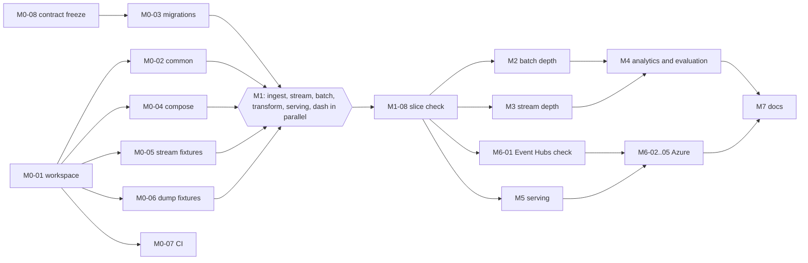

# Build plan

The build is sized for one developer working with AI agents. Milestones M0 to M7 are core: the project is
complete when they are done. O1 to O4 are optional and independent; skipping them removes nothing the core
depends on. `planning/status.json` holds every task below with its status. Each session reads it first, works
on tasks whose dependencies are `done`, and updates it.

## Working rules

- **Contracts first.** The event schemas, table contracts, OpenAPI spec and configuration layout in
  `docs/contracts/` and `config/` are frozen at M0-08. A workstream that needs a contract change stops and asks
  the lead. The lead changes the contract, and every affected workstream picks up the change.
- **Disjoint ownership.** Each workstream writes only inside its owner paths. Shared files (`compose.yaml`, root
  `pyproject.toml`, `uv.lock`, `Makefile`, the Dagster `definitions.py`) belong to the lead, who integrates each
  workstream's additions.
- **Python layout.** Python is a uv workspace with one member per directory: `libs/common`, `services/ingest`,
  `services/stream_processor`, `services/api`, `orchestration`. Each member declares its own pinned
  dependencies, and the lead regenerates `uv.lock`.
- **Review.** A task counts as `done` only after the lead has reviewed the diff, run its done check, and run the
  checks of every task that depends on the changed paths.
- **Commits.** After each coherent unit passes its checks, the lead stops and gives the user one commit command
  with explicit paths. Work that builds on it starts after the user confirms.
- **Fixtures.** Fixtures are real captured slices, with their source recorded in a `SOURCE.json` next to them:
  URL, capture time, and any transformation (for example, identity fields replaced).

## Workstreams

| Workstream | Owner paths | Inputs | Outputs | Contracts depended on |
|---|---|---|---|---|
| WS-lead | `docs/`, `config/`, `planning/`, `tests/e2e/`, `compose.yaml`, `Makefile`, root `pyproject.toml`, `uv.lock`, `.env.example`, `.gitignore`, `orchestration/src/wikipulse_orchestration/definitions.py` | all workstream outputs | integrated stack, e2e checks, docs | all |
| WS-common | `libs/common/` | config layout | `wikipulse_common`: config, logging, HTTP client, Kafka config, telemetry, data-root guard | config layout |
| WS-db | `migrations/` | table contracts for `ops`, `stream`, `enrich`, `mart` | dbmate migrations, roles | `docs/contracts/tables/{ops,stream,enrich,mart}.*.yaml` |
| WS-ingest | `services/ingest/`, `tests/fixtures/page_change/` | EventStreams | `wikipulse.page_change.v1`, DLQ, `ops.stream_checkpoint`, `ops.stream_gaps` | upstream subset schema, `page_change_event.v1`, `dlq_event.v1` |
| WS-stream | `services/stream_processor/` | `wikipulse.page_change.v1` | `bronze.page_change_events`, `stream.*`, late topic | `page_change_event.v1`, `late_event.v1`, `wiki_activity_window.v1`, bronze and stream tables |
| WS-batch | `orchestration/` (except `definitions.py`), `tests/fixtures/{pageviews,xml,history,pageview_complete}/` | dumps, Action API, Wikidata | raw files, bronze tables, `ops.batch_manifest`, `enrich.*`, `mart.*` via publish | bronze, ops, enrich, mart tables |
| WS-transform | `transform/` | bronze tables | silver and gold tables, dbt tests | bronze, silver, gold tables |
| WS-serving | `services/api/` | `mart.*`, `stream.*`, `ops.pipeline_freshness` | API, Postman collection | `openapi.yaml`, mart and stream tables |
| WS-dash | `dashboards/` | `mart.*`, `stream.*`, `ops.*` | Grafana provisioning and dashboards | mart, stream, ops tables |
| WS-infra | `infra/`, `.github/workflows/`, `deploy/` | images, configuration | Terraform, CI/CD, Azure runtime configuration | config layout, topic names |

Inside WS-batch, separate agents may take the subpackages `pageviews/`, `xml_snapshot/`, `history/`,
`enrichment/`, `labels/` and `publish/` under `orchestration/src/wikipulse_orchestration/`, since they share no
files.

## Parallelisation map

| Phase | Runs at the same time | Waits for |
|---|---|---|
| M0 | M0-02, M0-04, M0-05, M0-06, M0-07 after M0-01; M0-08 any time | M0-03 waits for M0-08 |
| M1 | M1-01, M1-02, M1-03, M1-04, M1-06, M1-07 | M0 done; M1-05 waits for M1-03 and M1-04; M1-08 waits for all |
| M2 and M3 | M2 and M3 run fully in parallel; within M2, tasks M2-01 to M2-04 are parallel | M1-08 |
| M4 | M4-01, M4-03, M4-05 in parallel; M4-02 after M3-02 | M2, M3-02 |
| M5 | M5-01 and M5-03 can start after M1 against fixture data, in parallel with M2 to M4 | M5-04 waits for M5-02 |
| M6 | M6-01 after M1-08; Terraform authoring (M6-02) after M6-01 | M6-05 waits for M5-01 |
| M7 | last | M4-09, M5-03, M6-05 |

The critical path is M0-01 → M0-02 → M1 → M1-08 → M2-05 → M4-02 → M4-06 → M4-09 → M7.

## Milestones and tasks

The definition of done for each milestone is a command that exits 0 on the integrated stack, plus the done
checks of its tasks. M1 deliberately ends with a thin but genuine end-to-end slice: the live stream and one
real dewiki pageview hour flow through bronze, silver, gold, the serving marts, the API and the dashboard.

### M0. Foundations and frozen contracts (core)

| Task | Workstream | Work | Depends on | Done check |
|---|---|---|---|---|
| M0-01 | WS-lead | uv workspace root, Makefile, .gitignore, .env.example, config/wikipulse.toml with every section (http, wikis, stream, windows, batch, lake, detection, api, telemetry) | - | uv sync --frozen && make help exits 0, and config/wikipulse.toml parses with python3 -c "import tomllib; tomllib.load(open('config/wikipulse.toml','rb'))" |
| M0-02 | WS-common | Common library: config loader with env overrides, JSON logging, HTTP client (User-Agent, per-host token bucket, Retry-After, backoff, maxlag), Kafka client config for local and Event Hubs profiles, OpenTelemetry setup, data-root mount guard | M0-01 | uv run pytest libs/common -q passes, including tests against a local HTTP server that returns 429 with Retry-After and 503 maxlag, and a guard test on an unmounted path |
| M0-03 | WS-db | dbmate migrations for schemas ops, stream, enrich, mart, the read-only role, and every postgres table contract | M0-01, M0-08 | make db-migrate && make db-rollback-check (up, down, up) exits 0 and make contracts-check-db reports no column differences against docs/contracts/tables/postgres tables |
| M0-04 | WS-lead | compose.yaml base: kafka 4.4.0 KRaft, postgres 18, prometheus, grafana; memory limits; SSD named volumes; HDD bind mount from WIKIPULSE_DATA_ROOT; healthchecks | M0-01 | make up-base && make ps-healthy reports every container healthy; docker stats --no-stream shows each container under its limit |
| M0-05 | WS-ingest | Capture real fixtures: 2,000 page_change events with SSE ids (identity fields replaced by placeholder strings before saving) plus SOURCE.json (url, captured_at, transformation) | M0-01 | test -s tests/fixtures/page_change/events.jsonl && uv run pytest services/ingest -k fixtures validates every fixture against the vendored upstream schema |
| M0-06 | WS-batch | Capture real fixtures: contiguous en, en.m, de, de.m slices of one pageview hour (50k lines total), one dewiki stub-meta-current slice cut at a page boundary, 10k History TSV lines (names and IPs replaced), 5k pageview_complete lines; each with SOURCE.json | M0-01 | uv run pytest orchestration -k fixtures parses every fixture with zero malformed lines and checks SOURCE.json fields |
| M0-07 | WS-infra | CI workflow: ruff, pytest per workspace member, JSON Schema and table-contract validation, OpenAPI lint | M0-01 | act -j ci (or a pushed branch) runs green; the contract job fails when a table YAML is made invalid |
| M0-08 | WS-lead | Freeze contracts: review event schemas, table contracts, OpenAPI and config layout; mark frozen | - | docs/contracts validated by the M0-07 contract job; status of this task is done before any M1 task starts |

Milestone definition of done: `make up-base && make ps-healthy && make db-rollback-check && uv run pytest -q, with the CI contract job green and M0-08 marked done`

### M1. Thin end-to-end slice (dewiki, live stream, one real pageview hour) (core)

| Task | Workstream | Work | Depends on | Done check |
|---|---|---|---|---|
| M1-01 | WS-ingest | Ingest service: SSE client, Last-Event-ID checkpoint after flush, canary drop, schema validation with drift handling, pseudonymisation, produce with key wiki_id:page_id, DLQ, metrics, Dockerfile | M0-02, M0-03, M0-05, M0-08 | uv run pytest services/ingest passes; after make up and 2 minutes, make check-ingest shows >1,000 messages on wikipulse.page_change.v1 and an ops.stream_checkpoint updated within 10 s |
| M1-02 | WS-stream | Stream processor: dedup state, bronze sink to DuckLake with offset ranges, 1-minute per-wiki x editor_type windows upserted to stream.wiki_activity_minute | M0-02, M0-03, M0-08 | uv run pytest services/stream_processor passes (fixture replay with injected duplicates yields unique bronze event_ids); after make up, stream.wiki_activity_minute has rows for the last 3 closed minutes |
| M1-03 | WS-batch | Assets: pageviews_hourly (single partition, manifest, raw retention, bronze) and page_snapshot_xml (dewiki, md5 verified), Dagster definitions | M0-02, M0-03, M0-06, M0-08 | make materialize ASSET=pageviews_hourly PARTITION=<recent hour> and ASSET=page_snapshot_xml PARTITION=dewiki/<run> leave manifest rows status=loaded with row counts; rerunning either leaves row counts unchanged |
| M1-04 | WS-transform | dbt project on DuckLake: sources, silver.page_change, silver.page_snapshot, silver.page_versions (snapshot only), silver.pageviews_hourly with title resolution, dim_wiki, dim_page, fct_pageviews_hourly, fct_wiki_activity_hourly, tests | M0-06, M0-08 | make dbt-build-fixtures passes in CI; on live data make dbt-build passes and reports the resolved-views share for the loaded dewiki hour |
| M1-05 | WS-batch | publish_serving asset for mart.wiki_activity_hourly, mart.page_activity_hourly, mart.page_current | M1-03, M1-04, M0-03 | make materialize ASSET=publish_serving leaves row counts in mart tables equal to the gold partitions; rerun is a no-op |
| M1-06 | WS-serving | API: /healthz, /readyz, /v1/freshness, /v1/wikis, /v1/wikis/{wiki_id}/activity, /v1/pages/top-viewed per openapi.yaml, connection pool, read-only role | M0-02, M0-03, M0-08 | uv run pytest services/api passes against a migrated Postgres loaded from fixtures; responses validate against docs/contracts/openapi.yaml |
| M1-07 | WS-dash | Grafana provisioning: Postgres datasource (read-only), analyst dashboard v1 (per-minute wiki activity, top viewed pages per hour, freshness) | M0-03, M0-04 | make up then make dash-check queries every panel through the Grafana /api/ds/query endpoint with zero errors |
| M1-08 | WS-lead | End-to-end slice check: live events and one real dewiki pageview hour through every layer to API and dashboard | M1-01, M1-02, M1-03, M1-04, M1-05, M1-06, M1-07 | make up && make slice-check asserts non-zero rows in bronze, silver, gold, stream and mart tables, non-empty API responses for dewiki, and freshness lag under 5 min for the stream |

Milestone definition of done: `make up && make slice-check`

### M2. Batch depth: backfill, XML at scale, history, page identity, data quality (core)

| Task | Workstream | Work | Depends on | Done check |
|---|---|---|---|---|
| M2-01 | WS-batch | Pageviews backfill and incremental modes, republication sweep, 3-connection limit, raw retention, en and de | M1-08 | make backfill PROFILE=quick loads 192 hours; a second run downloads nothing; editing one manifest row's size and running the sweep reloads exactly that hour |
| M2-02 | WS-batch | stub-meta-current for enwiki (27 parts) and dewiki, multi-part manifest, peak RSS measured | M1-08 | all parts status=loaded with md5 match; asset_peak_rss_bytes for the enwiki run under 400 MB |
| M2-03 | WS-batch | MediaWiki History TSV loader (3 months, en and de), column-count check, pseudonymisation while parsing | M1-08 | manifest rows loaded for 6 wiki-months; bronze.mediawiki_history has no column holding user text or IP (contract test) |
| M2-04 | WS-batch | pageview_complete reconciliation loader (one day per week) | M1-08 | manifest rows loaded for the configured days |
| M2-05 | WS-transform | SCD2 silver.page_versions from snapshots and stream lifecycle events, fct_page_lifecycle_event, fct_revision, redirect attribution, pageviews_unresolved with retry window | M1-08 | make dbt-build passes; a fixture page renamed by a stream move event resolves old-title hours to the old version and new-title hours to the new version (dbt unit test) |
| M2-06 | WS-transform | Data-quality tests: uniqueness, relationships, accepted values, freshness, volume, reconciliation against pageview_complete, snapshot vs stream state | M2-04, M2-05 | make dbt-test passes on live data; gold.dq_reconciliation has a row for every check and period with passed recorded |
| M2-07 | WS-lead | Measure batch throughput and memory per asset; record in architecture.md | M2-01, M2-02, M2-03 | architecture.md contains measured rows/s, MB/s and peak RSS per asset from a real run |

Milestone definition of done: `make backfill PROFILE=quick && make dbt-build && make dbt-test, with every gold.dq_reconciliation row passed`

### M3. Stream depth: resume, late data, schema drift, reconciliation (core)

| Task | Workstream | Work | Depends on | Done check |
|---|---|---|---|---|
| M3-01 | WS-ingest | Resilience: reconnect with backoff, 15-minute server timeout, gap detection into ops.stream_gaps, schema drift and DLQ reasons | M1-08 | uv run pytest services/ingest -k resilience: a local SSE server replaying fixtures with 5 forced disconnects and one SIGKILL of the ingest process loses zero event_ids |
| M3-02 | WS-stream | Per-page 60-minute hopping windows into stream.page_activity_window, late routing via on_late, future_timestamp DLQ, dedup state TTL | M1-08 | uv run pytest services/stream_processor -k windows: a reordered fixture replay produces the expected late-topic messages and window values |
| M3-03 | WS-transform | Stream vs batch reconciliation models | M3-02, M2-05 | gold.dq_reconciliation stream_vs_batch rows pass for 24 consecutive live hours |
| M3-04 | WS-lead | End-to-end chaos test: independent SSE capture for 20 minutes while ingest and processor are killed and restarted | M3-01, M3-02 | make chaos-check reports every captured event_id present in silver.page_change |
| M3-05 | WS-lead | 24-hour stream measurement: rate, size, lag, memory; update architecture.md | M3-01, M3-02 | architecture.md stream volume row updated with 24 h numbers |

Milestone definition of done: `uv run pytest services/ingest services/stream_processor && make chaos-check`

### M4. Analytics and evaluation (core)

| Task | Workstream | Work | Depends on | Done check |
|---|---|---|---|---|
| M4-01 | WS-transform | fct_trending_hourly (robust z-score against 168 h median/MAD) | M2-05, M2-01 | dbt unit tests on hand-computed real fixture series pass; make dbt-build produces rows for every loaded hour |
| M4-02 | WS-transform | fct_edit_burst (Poisson tail against 28-day rate, distinct editor rule, merge of overlapping windows) | M2-05, M2-03, M3-02 | dbt unit tests with real fixture revision sequences pass |
| M4-03 | WS-transform | Reverts and eval_revert_agreement (confusion counts, agreement, kappa) | M2-03, M2-05 | gold.eval_revert_agreement populated for every overlapping wiki-month |
| M4-04 | WS-transform | fct_read_edit_overlap and editor mix | M4-01, M4-02 | make dbt-build passes; overlap lead_minutes distribution query returns rows |
| M4-05 | WS-batch | eval_labels asset: Portal:Current events and Main Page links for enwiki into bronze.eval_label_links (resolution to page_id happens in dbt) | M2-01 | bronze label rows for every day of the evaluation window; HTTP metrics show no 429 left unhandled |
| M4-06 | WS-transform | eval_detection_daily for trending and edit bursts with both baselines | M4-01, M4-02, M4-05 | gold.eval_detection_daily has rows per day, method and label set for the 28-day window |
| M4-07 | WS-batch | Enrichment asset: Action API categories, pageprops, redirects; Wikidata P31; cache with 7-day TTL | M4-01, M4-02 | second run within 7 days makes zero HTTP requests for cached pages; enrich tables populated |
| M4-08 | WS-batch | publish_serving for all marts | M4-04, M4-06, M4-07 | row counts in every mart equal the published gold partitions |
| M4-09 | WS-lead | Run the 35-day backfill and evaluation; record results in data-model.md | M4-08 | data-model.md contains measured precision@20 and recall per method and label set with baselines |

Milestone definition of done: `make backfill PROFILE=full && make dbt-build && make evaluate, with results recorded in data-model.md`

### M5. Serving: API, Postman, dashboards (core)

| Task | Workstream | Work | Depends on | Done check |
|---|---|---|---|---|
| M5-01 | WS-serving | All API endpoints with keyset pagination, filters, range limits, problem+json errors, metrics | M1-06, M0-08 | uv run pytest services/api passes including schemathesis against docs/contracts/openapi.yaml |
| M5-02 | WS-serving | Postman collection generated from openapi.yaml with response tests; Newman run | M5-01 | make newman runs the collection against the local stack with zero failures |
| M5-03 | WS-dash | Analyst dashboard (wiki, namespace, time range, editor type filters; trending, bursts, overlap, editor mix, freshness) and ops dashboard with alert rules | M1-07, M0-08 | make dash-check passes for every panel on both dashboards |
| M5-04 | WS-infra | CI end-to-end job: compose stack with fixture replay, Newman | M5-02, M1-08 | the e2e workflow is green on a pushed branch |

Milestone definition of done: `make up && make newman && make dash-check`

### M6. Azure deployment (core)

| Task | Workstream | Work | Depends on | Done check |
|---|---|---|---|---|
| M6-01 | WS-infra | Event Hubs compatibility check: Quix with pre-created topics, OAUTHBEARER via managed identity, no compression | M1-08 | a Container App processor consumes from Event Hubs and writes stream.wiki_activity_minute for 30 minutes without errors |
| M6-02 | WS-infra | Terraform: resource group, ADLS Gen2 with lifecycle, Event Hubs and topics, PostgreSQL Flexible with Entra, Key Vault, Log Analytics and App Insights, Container Apps environment, apps and jobs, identities, budget alert | M6-01 | make azure-up completes and make azure-smoke passes; make azure-down leaves the workload resource group deleted |
| M6-03 | WS-common | Azure profiles: Event Hubs token callback, Azure Monitor exporter, abfss DuckLake data path with managed identity | M6-01 | uv run pytest libs/common -k azure passes; the azure profile runs in M6-02 smoke |
| M6-04 | WS-infra | GitHub Actions: image build to GHCR, OIDC deploy workflow | M6-02 | workflow_dispatch deploy succeeds without stored client secrets |
| M6-05 | WS-lead | Azure run: up, backfill quick profile, 24 h live, down; record timings and actual cost | M6-02, M6-03, M6-04, M5-01 | architecture.md contains measured up/down times and Cost Management spend |

Milestone definition of done: `make azure-up && make azure-smoke && make azure-down`

### M7. Documentation with measured results (core)

| Task | Workstream | Work | Depends on | Done check |
|---|---|---|---|---|
| M7-01 | WS-lead | README with diagram, run instructions, test approach and real numbers | M4-09, M5-03, M6-05 | README sections present; every number in it traces to a recorded run |
| M7-02 | WS-lead | Update architecture.md, data-model.md and ADRs with measured results and any changed decisions | M4-09, M6-05 | no section of the docs still describes a plan that differs from the built system |

Milestone definition of done: `every number in README.md and docs/ traces to a recorded run (M7-01, M7-02 done checks)`

### O1. Optional: API Management gateway (optional)

| Task | Workstream | Work | Depends on | Done check |
|---|---|---|---|---|
| O1-01 | WS-infra | API Management Consumption tier in front of the API with a rate-limit policy | M6-02 | requests through the gateway succeed and the policy returns 429 above the limit |

Milestone definition of done: `O1-01 done check`

### O2. Optional: Lift Wing topic enrichment (optional)

| Task | Workstream | Work | Depends on | Done check |
|---|---|---|---|---|
| O2-01 | WS-batch | Lift Wing outlink-topic-model enrichment for trending pages | M4-07 | topic labels stored for every trending page in the window |

Milestone definition of done: `O2-01 done check`

### O3. Optional: dewiki evaluation labels (optional)

| Task | Workstream | Work | Depends on | Done check |
|---|---|---|---|---|
| O3-01 | WS-transform | dewiki evaluation labels (Hauptseite news section) and evaluation | M4-06 | gold.eval_detection_daily has dewiki rows |

Milestone definition of done: `O3-01 done check`

### O4. Optional: Dagster UI on Azure (optional)

| Task | Workstream | Work | Depends on | Done check |
|---|---|---|---|---|
| O4-01 | WS-infra | Dagster webserver on Azure behind authentication | M6-02 | Dagster UI reachable on Azure showing asset history |

Milestone definition of done: `O4-01 done check`

## Risks

| Risk | Effect | Mitigation |
|---|---|---|
| Quix Streams on Event Hubs Standard (changelog topics, admin API, no transactions) | stream processor cannot run on Azure | M6-01 runs right after M1, before any other Azure work. If it fails, the fallback is a self-hosted single-node Kafka Container App, recorded in ADR 0002. |
| Upstream schema or stream changes during the build | ingest DLQ fills | drift metric and DLQ reasons; vendored schemas updated as a contract change |
| Pageview republication or delayed hours | gaps or stale values | republication sweep; freshness alert at 6 h |
| Memory on the 7 GB machine while other workloads run | OOM kills during backfill | compose memory limits, DuckDB `memory_limit`, `quick` profile; peak RSS measured in M2-07 |
| External HDD unplugged | writes to the empty mountpoint on the SSD | data-root guard refuses to start |
| Azure credit | spend exceeds $100 | session-based use, budget alert in Terraform, `make azure-down` |
